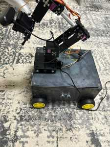
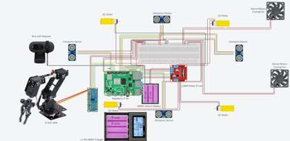

# Tomato Picker & Sorting Robot

My graduation project (Computer Engineering, Qassim University, 2025).

A small mobile robot that moves along a path, looks for tomatoes with a camera, picks the ripe ones with a 6-DOF arm and drops them in a box on the robot. Unripe and rotten tomatoes are skipped.

<p>
  
  
  
</p>

## How it works

1. The robot drives a planned route on a grid (A* path planning) and uses 4 ultrasonic sensors to avoid obstacles.
2. The camera checks the tomatoes in front of it.
3. A CNN classifies each tomato as **ripe / unripe / rotten**.
4. If it's ripe, the arm moves to it, grabs it and drops it in the box.
5. At the end of the route the robot unloads the box at the collection point.

The CNN reached about **94% validation accuracy** (≈98% training) on our 3-class tomato dataset.

## Hardware

- Raspberry Pi 4B (main controller)
- 6-DOF robotic arm + gripper, servos driven by a PCA9685 board
- 4WD chassis with TT motors + L298N motor driver
- HC-SR04 ultrasonic sensors (front, left, right, back)
- Logitech Brio 100 webcam
- 18650 Li-ion battery pack



## Code

```
navigation/   path planning (A*) + motor control + obstacle avoidance
picking/      camera detection of red tomatoes + arm / gripper control
classifier/   training script for the ripe / unripe / rotten CNN
```

Install:

```bash
pip install -r requirements.txt
```

Run (on the Raspberry Pi):

```bash
python navigation/navigate.py
python picking/pick_tomato.py
```

Train the classifier (on a PC) with images in `data/train/<class>` and `data/val/<class>`:

```bash
python classifier/train.py --data data --epochs 20
```

> Pin numbers are in the top of each file. Change them to match your wiring.

## Notes

- Tested in a controlled indoor setup, not a real farm.
- Lighting changes affect the detection a lot. That's the main thing I'd improve next, plus a better gripper.

## Author

Yasir Ibrahim Alsekaiti
